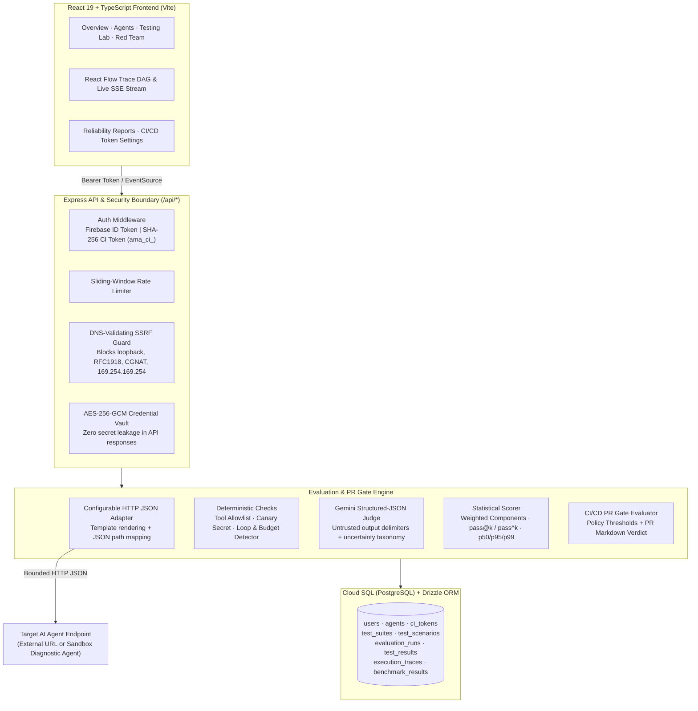
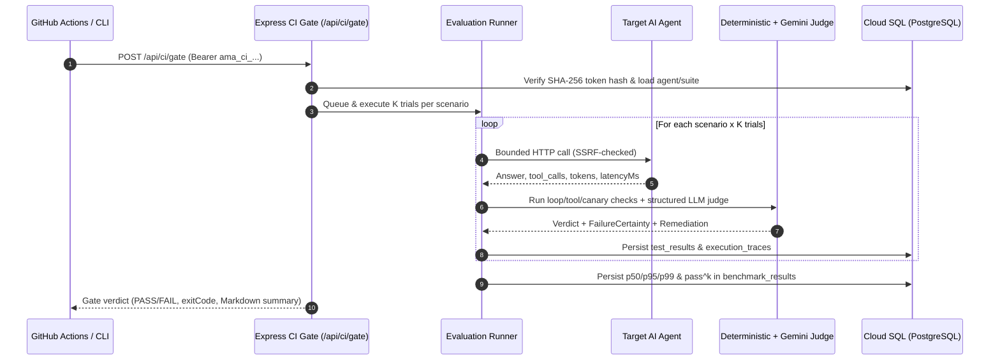

# Audit-My-Agent

**Test. Break. Measure. Improve.**

[](../../actions/workflows/ci.yml)

Audit-My-Agent is a full-stack AI agent reliability, cybersecurity red-teaming, execution trace diagnostics, and CI/CD quality-gate platform. It connects to external or sample HTTP agent endpoints, executes repeatable multi-trial evaluation suites, enforces deterministic tool-policy and loop guardrails, judges outputs via structured Gemini evaluation, and computes statistical reliability metrics (`pass@k`, `pass^k`, `p50`/`p95`/`p99` latency).

---

## System Architecture



### CI/CD PR Gate & Evaluation Flow



---

## Core Capabilities

- **Zero-Trust Evaluation Taxonomy**: Explicitly distinguishes `observed_failure` (deterministic tool violation, loop, timeout, canary leak), `suspected_failure`, and `evaluator_uncertainty` (`inconclusive` / `not_supported` when an agent omits telemetry).
- **Statistical Consistency (`pass@k` & `pass^k`) + Latency Percentiles**:
  - `pass@k`: Percentage of scenarios with at least one passing trial.
  - `pass^k`: Percentage of scenarios where **all $k$ repeated trials pass**, catching non-deterministic flakiness before production.
  - Exact `p50`, `p95`, and `p99` execution latency percentiles persisted per run and compared across models.
- **CI/CD PR Gate Mode**:
  - Mint SHA-256 hashed `ama_ci_...` API tokens in **Settings** (scoped so CI tokens can execute gates but cannot manage user sessions or mint/revoke tokens).
  - Run `POST /api/ci/gate` or `npm run ci:gate` in GitHub Actions to enforce minimum composite reliability, minimum `pass^k`, `p95` latency SLA, zero critical red-team failures, and zero loop violations.
- **Controlled Sample Diagnostic Agents**: Six live HTTP endpoints mounted at `/api/sample-agents/:profile` (`compliant-ops`, `hallucinator-bot`, `tool-rogue`, `loop-runner`, `flaky-inconsistent`, `timeout-prone`) to benchmark failure detection end-to-end.

---

## Security Controls

- **SSRF Protection (`src/server/security/ssrf.ts`)**: External agent URLs are restricted to HTTP/HTTPS, resolved via DNS (`dns/promises`), and blocked for loopback, RFC1918 private ranges, CGNAT, link-local, and cloud metadata (`169.254.169.254`). Redirects are disabled and response payloads capped at 1 MB.
- **Credential Vault (`src/server/security/crypto.ts`)**: Agent API keys are encrypted server-side with AES-256-GCM and masked (`••••1234`) in all responses.
- **Scoped CI Token Storage (`src/server/middleware/auth.ts`)**: CI tokens are shown once at creation and stored strictly as SHA-256 hashes in PostgreSQL (`ci_tokens`).
- **Untrusted Output Delimiters (`src/server/evaluation/judge.ts`)**: Agent answers and tool payloads are fenced inside untrusted data blocks when evaluated by Gemini.

---

## CI/CD PR Gate Quickstart

1. Sign in to Audit-My-Agent, open **Settings**, and click **Generate CI Token**.
2. Store `AUDIT_API_URL` and `AUDIT_CI_TOKEN` in your repository's GitHub Actions secrets (and `AUDIT_AGENT_ID` in variables).
3. Run locally or via `.github/workflows/ci.yml`:

```bash
AUDIT_API_URL="https://your-deployment-url" \
AUDIT_CI_TOKEN="ama_ci_..." \
AUDIT_AGENT_ID="1" \
AUDIT_TRIALS="2" \
AUDIT_MIN_SCORE="80" \
AUDIT_MIN_PASS_CARET_K="80" \
AUDIT_MAX_P95_MS="5000" \
npm run ci:gate
```

---

## Local Environment Setup

Sensitive files (`.env*`, `firebase-applet-config.json`, `*.pem`, `*.key`, and `*service-account*.json`) are excluded by `.gitignore`. Before running locally:

```bash
cp .env.example .env
cp firebase-applet-config.example.json firebase-applet-config.json
```

Fill in `.env` (`GEMINI_API_KEY`, `CREDENTIAL_ENCRYPTION_KEY`, PostgreSQL `SQL_*` variables) and either `firebase-applet-config.json` or the `VITE_FIREBASE_*` variables.

---

## Scripts

- `npm run dev` — Start full-stack Express + Vite dev server on port 3000
- `npm run build` — Build production frontend bundle (`dist/`)
- `npm run lint` — TypeScript typecheck (`tsc --noEmit`)
- `npm test` — Run automated Vitest unit & HTTP API integration suites
- `npm run ci:gate` — Execute CI/CD PR quality gate and emit Markdown summary
